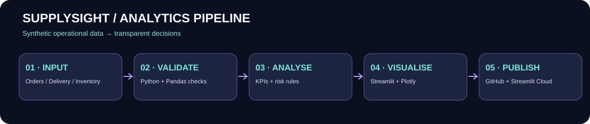

# ◈ SupplySight — Global Operations Intelligence

**A portfolio-ready Streamlit command centre for supply-chain visibility, delivery reliability and inventory exposure.**

> **Demo data notice:** This repository contains entirely synthetic data. Figures do not represent actual companies, carriers, shipments or market outcomes.

## What it does

SupplySight translates operational records into interactive decision-support views. It is deliberately distinct from a housing-affordability dashboard and from a SaaS revenue analytics product.

| Workspace | Business question |
|---|---|
| Command centre | What is the value and reliability of our fulfilment pipeline? |
| Delivery performance | Which carriers and regions are experiencing delays? |
| Inventory risk | Which SKUs need replenishment or may run out before replenishment? |
| Scenario lab | What could better delivery performance and lower shipping costs mean? |
| Data quality & methodology | Are the input records complete, and how are metrics defined? |

### Technical stack
Python · Pandas · NumPy · Plotly · Streamlit · CSV · GitHub

## Architecture



The application currently reads included CSV files. The pipeline is intentionally file-based and does **not** claim to have a production database, real-time integrations, or deployed automation.

## Quick start

```bash
git clone https://github.com/YOUR_USERNAME/supplysight-operations-intelligence.git
cd supplysight-operations-intelligence
python -m pip install -r requirements.txt
python -m streamlit run app.py
```

Open http://localhost:8501.

## Deploy to Streamlit Community Cloud

1. Push all repository files, including `data/`, to GitHub.
2. Open https://share.streamlit.io and select **Create app**.
3. Select your repository, `main` branch and `app.py`.
4. Deploy, then add the public app URL here.

**Live app:** _Add your Streamlit URL_

## Dataset

Three reproducible synthetic CSVs are included:

- `data/orders.csv`: 3,200 order records, order value, shipping costs, dates, carrier and destination.
- `data/delivery_events.csv`: 3,200 delivery events with delivery delays and on-time flags.
- `data/inventory.csv`: 400 inventory SKUs with stock, reorder points, demand and lead times.

These data are simulated and **not suitable for factual market or carrier comparisons**.

### Upload your own data

The sidebar accepts an orders CSV with these fields:

`order_id, order_date, promised_date, delivery_date, region, destination, category, carrier, units, order_value_gbp, shipping_cost_gbp, status`

When an orders file is uploaded, delivery events are recalculated from it. The inventory view continues using the included synthetic inventory data.

## KPI logic

- **On-time delivery** = delivered orders where `delivery_date <= promised_date` / all delivered orders.
- **Order value** = sum of `order_value_gbp`, not recognised accounting revenue.
- **Days of cover** = `on_hand / daily_demand`.
- **Reorder now** = `on_hand < reorder_point`.
- **Lead-time risk** = `days_of_cover < supplier_lead_days` (when not already flagged for reorder).
- **Scenario outputs** = deterministic what-if calculations, **not** ML predictions.

## Quality, assumptions and limitations

- Dates and currency are simulated; GBP is a display convention.
- Inventory is not linked to specific orders or SKUs; it is a separate synthetic dataset.
- Shipping savings are volume-adjusted in the simulator.
- Some data-quality checks are descriptive rather than enforced schema validation.
- The app is a portfolio prototype, not a production logistics control system.

## Roadmap

- [ ] PostgreSQL ingestion and dimensional modelling
- [ ] dbt transformations and automated tests
- [ ] GitHub Actions CI/CD
- [ ] SLA alerting and exception management
- [ ] Geospatial route visualisation
- [ ] Forecasting with backtesting and error reporting

## Portfolio talking points

This project demonstrates analytical engineering, operational KPI design, explainable business rules, interactive data visualisation, scenario analysis and transparent handling of synthetic datasets.

**Author:** Diego Alves  
**GitHub:** https://github.com/diegoallanalves

## License

MIT — see `LICENSE`.
